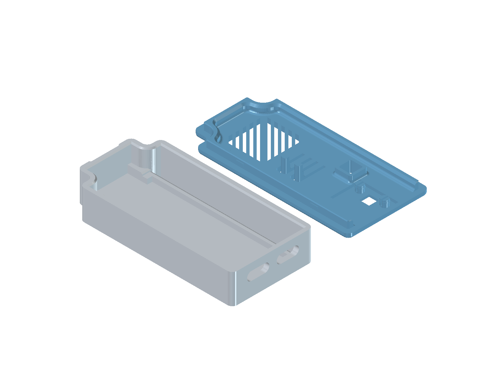

# ESP32-S3 RGB thermometer

[Suomeksi](README_fi.md)

An ESP32-S3 reads a BMP280 temperature sensor and displays the temperature
as a color on a NeoPixel LED. It also publishes readings to Home Assistant
over MQTT.

## Hardware

The tested configuration uses a generic ESP32-S3 N16R8 development board.
The `esp32s3usbotg` PlatformIO environment uses the
`freenove_esp32_s3_wroom` board definition, 16 MB of flash, and QIO/OPI
memory settings. Check compatibility with your board.

- BMP280 over I²C: SDA on GPIO 8, SCL on GPIO 9. The firmware checks
  addresses `0x76` and `0x77`.
- NeoPixel: GPIO 48. Verify the pins and wiring for your board.

## Setup

1. Install VS Code and the PlatformIO IDE extension (`platformio.platformio-ide`).
2. Open the repository folder, which contains `platformio.ini`, in VS Code.
3. Copy `bmp280_rgbled_ha/env.example.h` to `env.h` in the same directory
   and enter your Wi-Fi and MQTT settings. Keep `env.h` out of Git.
4. Connect a USB data cable to the board's COM or USB-UART port.
5. Open PlatformIO and select **Project Tasks → esp32s3usbotg → General**.
   **Build** compiles the firmware, **Upload** flashes it, and **Monitor**
   opens the serial log. Close the monitor before uploading. The serial
   baud rate is 115200.

The same commands are available in the PlatformIO terminal:

```sh
pio device list
pio run -e esp32s3usbotg
pio run -e esp32s3usbotg -t upload
pio device monitor -b 115200
```

PlatformIO detects the serial port automatically. If several boards are
connected, set `upload_port` and `monitor_port` in `platformio.ini` for the
board you want to use. You can open PlatformIO from the command palette
with **PlatformIO: Home**. **Devices** lists ports, **Inspect** shows
memory usage, and **Monitor** displays the serial log.

## How it works

The startup demo takes about 14 seconds. It runs through the color scale
in both directions and flashes red and blue. The LED then follows the
measured temperature. It stays off below 30 °C and changes from blue to
red between 30 °C and 40 °C. Press **RESET** to run the demo again.

The firmware tries MQTT immediately, then waits a minute between failed
attempts and stops after ten consecutive failures. A successful connection
resets the counter. The sensor and LED keep running between attempts.
An individual connection attempt can delay the main loop. Startup waits
for Wi-Fi. See the [known limitations](bmp280_rgbled_ha/TOIMINTA.md#known-limitations)
for missing sensors and connection recovery.

Each ESP32 derives its identifier from its factory MAC address and appears
in Home Assistant as a separate BMP280 device. Boards on the same Wi-Fi
network and MQTT broker can use the same firmware binary. Set each device's
name and area in Home Assistant.

[Adding a thermometer and upgrading an existing one](bmp280_rgbled_ha/TOIMINTA.md)

## Wiring and enclosure



The [wiring guide](bmp280_rgbled_ha/docs/README.md) includes a schematic
and a photo showing matching pins on the two boards.

[Download the enclosure (3MF)](bmp280_rgbled_ha/cad/Kotelo_2_5mm_hampaat.3mf) ·
[CAD source and printing instructions](bmp280_rgbled_ha/cad/README.md)

The enclosure has a low-profile base, 2.5 mm button extensions, and four
retaining tabs. It is based on [ESP32 S3 Wroom Case by aiekick](https://makerworld.com/en/models/1456361-esp32-s3-wroom-case).
