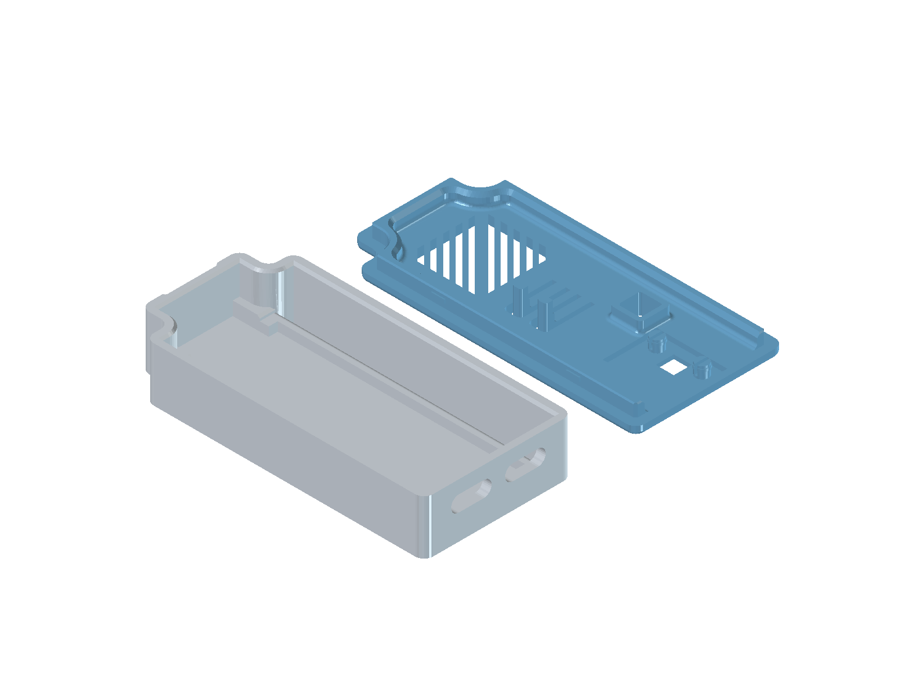

# 3D-printable enclosure

[Suomeksi](README_fi.md)

An enclosure for the ESP32-S3 and BMP280 assembly with a low-profile
base, flat lid, 2.5 mm button extensions, and four retaining tabs.

## Files

- [Base and lid (3MF)](Kotelo_2_5mm_hampaat.3mf)
- [Lid only (3MF)](Kansi_2_5mm_hampaat.3mf)
- [FreeCAD source for the base and lid](Kotelo_2_5mm_hampaat.FCStd)
- [Top view](kotelo_2_5mm_ylhaalta.png) · [Inside of the lid](kansi_2_5mm_sisapuoli.png)

## Printing

The 3MF contains the model geometry. Choose the print profile in your
slicer and check the orientation, layer preview, and material settings.
During assembly, check that the buttons move freely and the components
have enough clearance.

## Enclosure origin

The enclosure is based on [ESP32 S3 Wroom Case by aiekick](https://makerworld.com/en/models/1456361-esp32-s3-wroom-case).

### Changes from the original

- **Base.** Removed a 5 mm section above the bottom plate and added a
  2 mm rim above the USB openings. The resulting base is about 12 mm high.
- **Lid.** Flattened the top and filled the three small indicator LED
  holes. The lid has openings for the RGB LED and the BMP280 sensor.
- **Buttons.** Added 2.5 mm extensions to the BOOT and RESET actuators.
- **Lid fit.** Added four small retaining tabs along the long edges of
  the lid. The base has no matching recesses.
