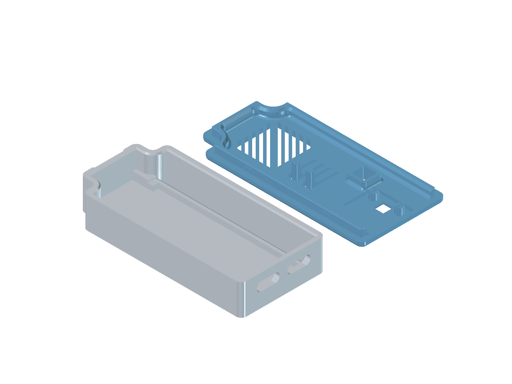

# Tulostettava kotelo

Kotelo ESP32-S3- ja BMP280-kokoonpanolle: madallettu pohja, tasainen kansi,
2,5 mm painikejatkot ja neljä kiinnityshammasta.

## Tiedostot

- [Pohja ja kansi – 3MF](Kotelo_2_5mm_hampaat.3mf)
- [Vain kansi – 3MF](Kansi_2_5mm_hampaat.3mf)
- [Pohjan ja kannen FreeCAD-lähde](Kotelo_2_5mm_hampaat.FCStd)
- [Kuva ylhäältä](kotelo_2_5mm_ylhaalta.png) · [Kannen sisäpuoli](kansi_2_5mm_sisapuoli.png)

## Tulostus

3MF sisältää geometrian, ei tulostusprofiilia. Tarkista tulostussuunta,
kerrosnäkymä ja materiaaliasetukset viipalointiohjelmassa.
Varmista kootessa painikkeiden vapaa liike ja komponenttien välykset.
