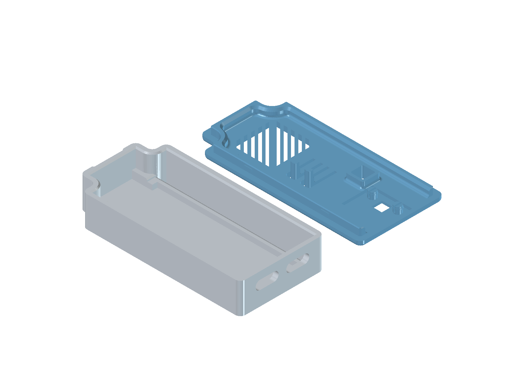

# Tulostettava kotelo

[English](README.md)

Kotelo ESP32-S3- ja BMP280-kokoonpanolle: madallettu pohja, tasainen kansi,
2,5 mm painikejatkot ja neljä kiinnityshammasta.

## Tiedostot

- [Pohja ja kansi – 3MF](Kotelo_2_5mm_hampaat.3mf)
- [Vain kansi – 3MF](Kansi_2_5mm_hampaat.3mf)
- [Pohjan ja kannen FreeCAD-lähde](Kotelo_2_5mm_hampaat.FCStd)
- [Kuva ylhäältä](kotelo_2_5mm_ylhaalta.png) · [Kannen sisäpuoli](kansi_2_5mm_sisapuoli.png)

## Tulostus

3MF sisältää geometrian, ei tulostusprofiilia. Tarkista tulostussuunta,
kerrosnäkymä ja materiaaliasetukset viipalointiohjelmassa.
Varmista kootessa painikkeiden vapaa liike ja komponenttien välykset.

## Kotelon alkuperä

Kotelo perustuu [aiekickin ESP32 S3 Wroom Case -malliin](https://makerworld.com/en/models/1456361-esp32-s3-wroom-case).

### Muutokset alkuperäiseen malliin

- **Pohja.** Poistimme 5 mm:n osuuden pohjalevyn yläpuolelta ja lisäsimme
  USB-aukkojen yläpuolelle 2 mm reunusta. Pohjan korkeus on noin 12 mm.
- **Kansi.** Tasoitimme pinnan ja suljimme kolme pientä merkkivaloaukkoa.
  Kannessa on aukot RGB-LEDille ja BMP280-anturille.
- **Painikkeet.** Lisäsimme BOOT- ja RESET-painikkeisiin 2,5 mm:n jatkot.
- **Kannen sovitus.** Lisäsimme kannen pitkille sivuille neljä pientä
  kiinnityshammasta. Pohjassa ei ole niille vastakoloja.
