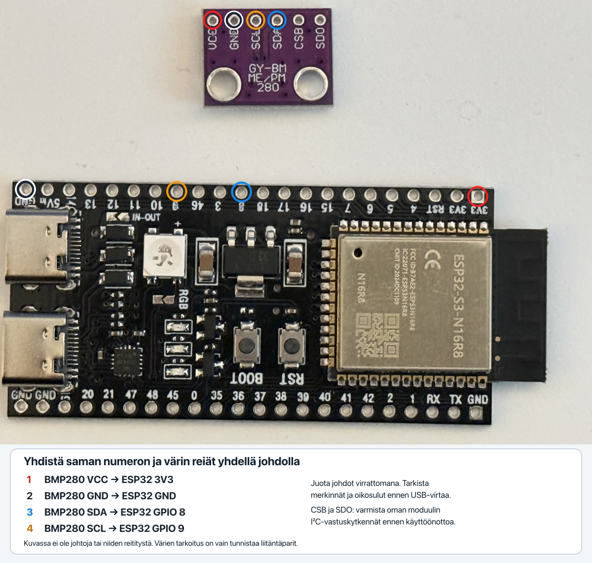
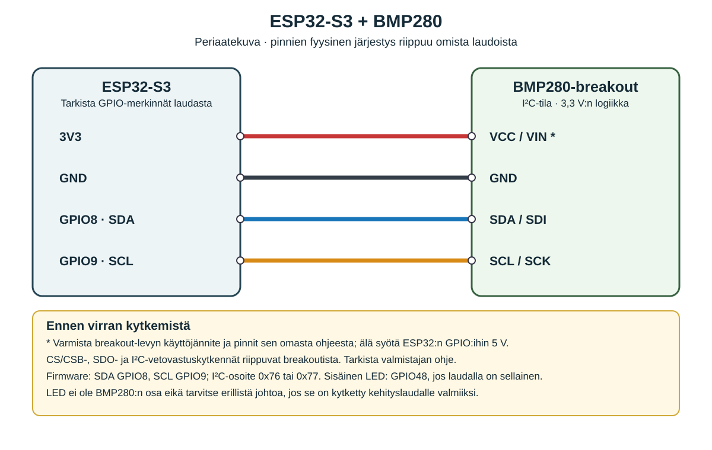

# Wiring guide

[Suomeksi](README_fi.md)

## Matching pins on the boards

[Open the vector image (SVG)](kytkennat-omilla-laudoilla.svg)

The photo shows the boards before wiring. Matching colored numbers
indicate which pins to connect.

## Schematic

Connect the BMP280's 3V3 and GND pins to the corresponding pins on the
ESP32-S3, SDA to GPIO 8, and SCL to GPIO 9. The onboard RGB LED uses
GPIO 48. Check your board's pinout and the sensor board's CSB, SDO, and
pull-up resistor connections. Verify the finished wiring against your
actual boards.
