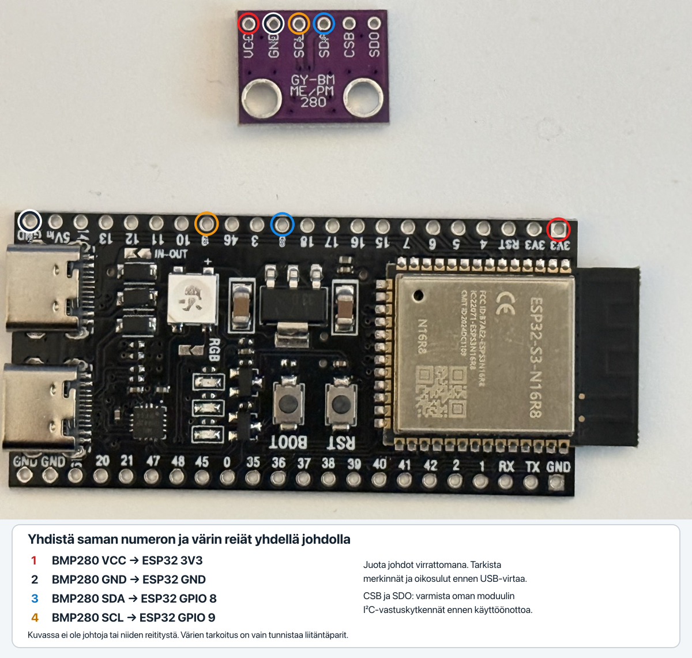
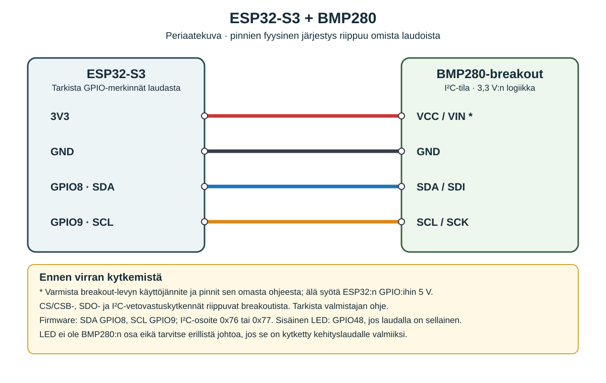

# Kytkentäkuvat

## Liitäntäparit omilla laudoilla

[Avaa vektorikuva (SVG)](kytkennat-omilla-laudoilla.svg).

Kuva on otettu ennen johdotusta. Värilliset numerot osoittavat liitäntäparit.

## Kytkentäkaavio

BMP280: 3V3, GND, SDA GPIO 8 ja SCL GPIO 9. Laudan oma RGB-LED: GPIO 48.
Tarkista oman laudan pinout sekä anturilevyn CSB-, SDO- ja vetovastuskytkennät.
Kuvat eivät varmista valmiin johdotuksen oikeellisuutta.
